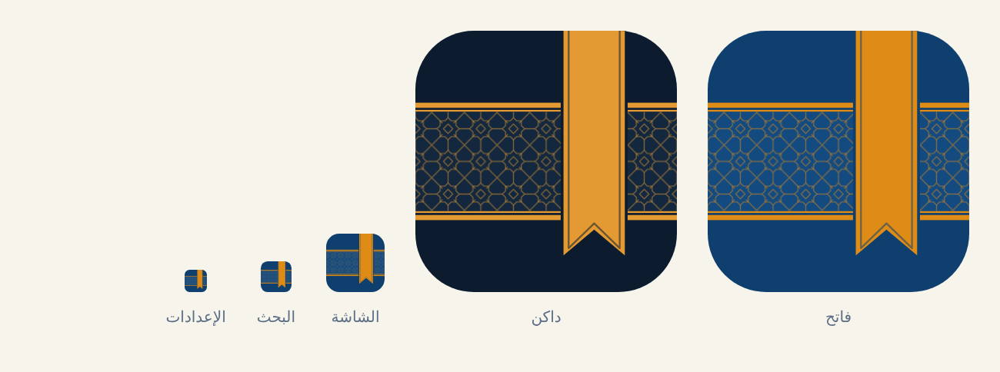

# أيقونة التطبيق

اعتمدها المالك في 9 نوفمبر 2026 (القرار 13 في `docs/decisions.md`، تنفيذاً للقسم 8.4).

## الفكرة
- **شريط عرضي** بنقش النجمة الثمانية والصليب، تحدّه مسطرتان ذهبيتان (غليظة ثم رفيعة) من أعلى وأسفل، كإطار رأس السورة في المصحف.
- **شريط علامة** برتقالي عريض على الجانب الأيمن، منسدل من أعلى الأيقونة، يعبر الشريط العرضي، وطرفه مشقوق. يدلّ على موضع التوقّف.
- مركز واحد، وألوان مسطّحة بلا ظلال ولا تدرّجات، ولا نصّ (فالاسم «الورد اليومي» اسم عمل، القرار 9).

## الملفات
| الملف | الاستعمال |
|---|---|
| `app-icon-light.svg` · `app-icon-light-1024.png` | الوضع الفاتح (الأساس) |
| `app-icon-dark.svg` · `app-icon-dark-1024.png` | الوضع الداكن في iOS |
| `app-icon-tinted.svg` · `app-icon-tinted-1024.png` | الوضع الملوّن (Tinted) في iOS 18 فما بعد (ش6، ذ48) |
| `preview.png` | معاينة: فاتح، داكن، 76 و40 و29 نقطة |

الصور 1024×1024 مربّعة بلا شفافية وبلا زوايا مستديرة، والنظام يستدير زواياها بنفسه. والوضع الملوّن بلون واحد (Tinted) له صورته المرسومة في ش6 (ذ48، `design/system.md` §17.5): رمادية على أسود، والعلامة أفتح ما فيها؛ لأن توليده من الفاتحة يذيب العلامة.

## القياسات (على لوح 1024)
- الأرضية: `#0F3F6E` (داكن: `#0C1C2E`).
- الشريط العرضي: من y=318 إلى y=706، لونه `#134A80` (داكن: `#13283E`)، والنقش بلون `#DF8C16` بشفافية 0.5 وخطّ 4.2، ووحدته 128.
- المسطرتان: أعلى 20 ثم 7 (y=282 و310)، وأسفل 7 ثم 20 (y=707 و722)، بلون `#DF8C16` (داكن: `#E39A33`).
- شريط العلامة: عرضه 240، ومركزه x=700، من أعلى اللوح إلى y=880، وعمق شقّه 101، ولونه `#DF8C16`. يحيط به فاصل كحلي 11 حيث يقطع المسطرتين، وفيه خطّ داخلي كحلي (شفافية 0.55، سماكة 7) على بعد 20 من حوافّه.

## للمهندس (في ش6 · الصقل)
تُضاف الصور الثلاث إلى `AppIcon` في Assets بصيغة iOS الحديثة (Any وDark وTinted)، ولا يُعدَّل التصميم عند الدمج.
